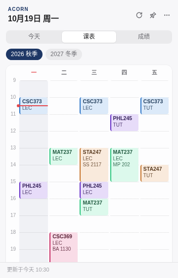
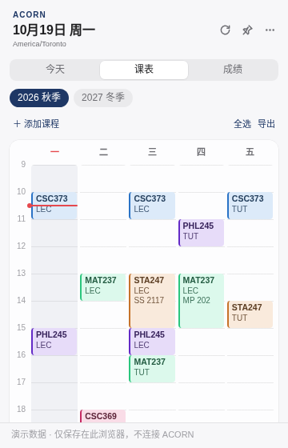
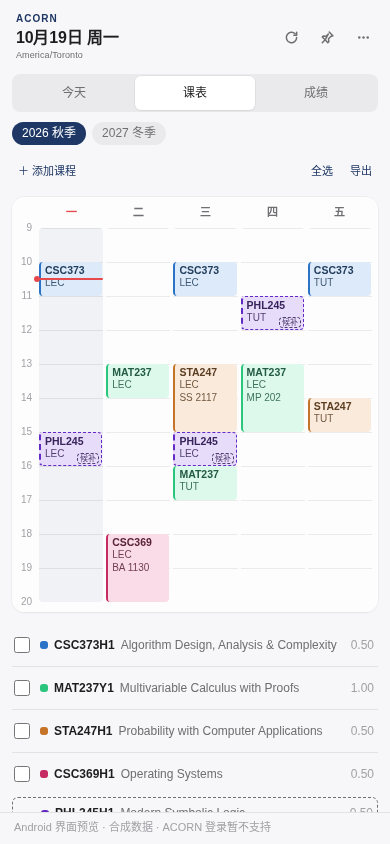

# Original-renderer visual comparison

All images contain **synthetic test data only**. They are headless Chromium renderer captures, not Windows or Android device screenshots. The phone-size capture uses the actual shared renderer with a simulated Android capability bridge. No private timetable, grades or login was loaded.

Original upstream Term view, 360×560:

Current same renderer, 360×560. Original colors, tabs, course blocks and grid are retained. Additions are the timezone line and course toolbar:

Current phone-size viewport, 390×844. A synthetic waitlist course demonstrates dashed blocks and labels; course list scrolls below the grid:

The native Android home-screen widget is a separate RemoteViews surface. These screenshots do not validate its exact Vivo launcher appearance, installed 5×7 cell sizing or resize behavior. Those remain device acceptance checks.
